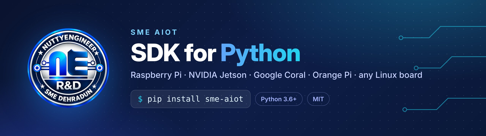

<p align="center">
  <a href="https://www.nuttyengineer.com/sdk/"></a>
</p>

<p align="center">
  <a href="https://pypi.org/project/sme-aiot/"></a>
  
  
  <a href="https://github.com/itsbhupendrasingh/sme-aiot-python/blob/main/LICENSE"></a>
  <a href="https://github.com/itsbhupendrasingh/SMEAIoT"></a>
</p>

<p align="center">
  <b>Connect a Raspberry Pi, Jetson, Coral or any Linux board to the SME AIoT cloud in a few lines of Python.</b><br>
  The same calls as the Arduino SDK for NuttyFi boards: <code>SME.begin</code>, <code>SME.publish</code>, <code>SME_LISTEN</code>, <code>SME.run</code>.
</p>

<p align="center">
  <a href="https://www.nuttyengineer.com/sdk/">SDK page</a> ·
  <a href="https://github.com/itsbhupendrasingh/sme-aiot-python">Source</a> ·
  <a href="https://github.com/itsbhupendrasingh/sme-aiot-python/blob/main/CHANGELOG.md">Changelog</a> ·
  <a href="https://github.com/itsbhupendrasingh/SMEAIoT">Arduino SDK</a>
</p>

---

## Install

```bash
pip install sme-aiot
```

Python 3.6 or newer; `paho-mqtt` is installed with it. On Raspberry Pi OS Bookworm and newer, use a
virtual environment (`python3 -m venv ~/sme && ~/sme/bin/pip install sme-aiot`) or add `--break-system-packages`.

## Quick start

```python
from smeaiot import SME, SME_LISTEN, TP0, TP1

SME_PRINT = True                     # logo + status lines, like  #define SME_PRINT Serial
DASHBOARD_ID = "PROJ-XXXXXXXX"       # from the SME AIoT app
DEVICE_TOKEN = "SME-XXXX-XXXX-XXXX"
FIRMWARE_VERSION = "1.0.0"           # your own program's version

@SME_LISTEN(TP0)                     # a Switch on TP0 in the app
def on_switch(data):
    print("Switch:", data.toInt())

def send_data():
    SME.publish(TP1, 23.5)           # a Value or Graph widget on TP1

SME.begin(DASHBOARD_ID, DEVICE_TOKEN, FIRMWARE_VERSION)
SME.clock.every(1000, send_data)     # every second

while True:
    SME.run()                        # = loop() { SME.run(); }
```

Run it with `python3 my_device.py` and you will see:

```
  _____ __  __ ______            _____   _______
 / ____|  \/  |  ____|     /\   |_   _| |__   __|
| (___ | \  / | |__       /  \    | |  ___ | |
 \___ \| |\/| |  __|     / /\ \   | | / _ \| |
 ____) | |  | | |____   / ____ \ _| || (_) | |
|_____/|_|  |_|______| /_/    \_\_____\___/|_|

v1.0.0 on Raspberry Pi 5 Model B Rev 1.0
Firmware: 1.0.0

[SME] Network connected, IP 192.168.1.50
[SME] Connecting to SME AIoT cloud...
[SME] Verifying device with the cloud...
[SME] Device verified & registered with the cloud
[SME] Server offered a real-time channel (MQTT) - connecting...
[SME] MQTT connected - live updates on; unplugged board shows offline in ~15s
[SME] First data sent - check the app graph
```

## Why this SDK

- **One set of calls**: write it once for a NuttyFi board, use the same calls on a Raspberry Pi.
- **Live and reliable**: real time over MQTT, with automatic fallback to HTTPS. Values published together arrive as one row.
- **Secure**: the server certificate is checked against a pinned root (ISRG Root X1).
- **Light**: `SME.run()` rests between rounds, about 2 % of one CPU core.
- **Runs almost anywhere**: Python 3.6+ (Jetson Nano included), paho-mqtt 1.6 or 2.x.

## Supported boards

| Raspberry Pi | NVIDIA | Google | Others |
|---|---|---|---|
| Pi 5, Pi 4 B, Pi 3 B, Pi Zero 2 W | Jetson Nano, Jetson Orin | Coral Dev Board | Orange Pi, Banana Pi, Radxa ROCK, ODROID, any Linux computer |

GPIO: `gpiozero` on a Raspberry Pi; on Jetson, Coral, Orange Pi and others their own GPIO library or Adafruit Blinka.
The Nutty Engineer Project Builder writes a complete program, with the parts and pins, for each of these boards.

## From an Arduino sketch to Python

| Arduino sketch | Python |
|---|---|
| `#include <SMEAIoT.h>` | `from smeaiot import SME, SME_LISTEN, TP0, TP1` |
| `#define SME_PRINT Serial` | `SME_PRINT = True` |
| `#define DASHBOARD_ID "..."` | `DASHBOARD_ID = "..."` |
| `SME_LISTEN(TP0) { payload.toInt(); }` | `@SME_LISTEN(TP0)` above `def on_tp0(payload):` |
| `SME.begin(ID, TOKEN, FW, ssid, pass);` | `SME.begin(ID, TOKEN, FW)` (the board's own network is used) |
| `void loop() { SME.run(); }` | `while True: SME.run()` (or `SME.run_forever()`) |
| `SME.publish(TP1, value);` | `SME.publish(TP1, value)` |
| `SME.clock.every(1000, fn);` | `SME.clock.every(1000, fn)`; also `after`, `pause`, `resume`, `stop` |
| `SME.messenger(TP15);` `SME.sendMessage(TP15, "hi");` | the same; the terminal plays the Serial Monitor |
| `SME.setDeadband(TP1, 0.5);` `SME.setMinInterval(TP2, 5000);` | the same |
| `SME.connected()`, `SME.mqttConnected()`, `SME.led(true)` | the same (`True`) |
| `payload.toInt() toFloat() toBool() toString()` | the same, plus `int(payload)`, `float(payload)`, `str(payload)` |

## Examples

| Example | What it does | Widgets |
|---|---|---|
| `InbuiltLED` | the board's LED follows a Switch | Switch TP0 |
| `SendValues` | sends two values every second | Value TP1, TP2 |
| `SliderToSerial` | prints a Slider's value | Slider TP3 |
| `ButtonToLEDWidget` | a button (GPIO 17, or Enter) lights an LED widget | LED TP4 |
| `Messenger` | chat between the terminal and the app | Messenger TP15 |
| `GraphSimulated`, `GraphSyncTest` | live graphs | Graph TP0-TP3 |
| `Linux/SystemMonitor` | CPU temperature, load, memory, disk, uptime | Value / Graph |
| `Linux/SendPolicy` | deadband and minimum interval | Value |

Get them from the [source](https://github.com/itsbhupendrasingh/sme-aiot-python/tree/main/examples), fill in the
three values at the top, and run `python3 examples/SendValues/SendValues.py`.

<details>
<summary><b>Run it as a service (starts with the board)</b></summary>

`/etc/systemd/system/sme-device.service`:

```ini
[Unit]
Description=SME AIoT device
After=network-online.target
Wants=network-online.target

[Service]
ExecStart=/usr/bin/python3 /home/pi/my_device.py
Restart=always
RestartSec=5
User=pi

[Install]
WantedBy=multi-user.target
```

```bash
sudo systemctl enable --now sme-device
journalctl -u sme-device -f        # the [SME] status lines
```
</details>

<details>
<summary><b>Server and settings</b></summary>

The SDK connects to the SME AIoT cloud. `SME.setServerUrl(url)` before `SME.begin()` points a program at another
server. The MQTT broker, port and login come from the registration reply, as on the board.

Settings have the same names and defaults as the Arduino SDK's `SMEConfig.h`, in `smeaiot.config`.
Change them before `SME.begin()`:

```python
import smeaiot.config as config
config.SME_FLUSH_INTERVAL = 100
config.SME_DEVICE_TYPE = "SME-Device"   # sent at registration
```

Old code with `import smeiot` keeps working; new code uses `smeaiot`.
</details>

<details>
<summary><b>What is different from a NuttyFi board</b></summary>

| | Board | Python on Linux |
|---|---|---|
| Network | the SDK joins WiFi | the operating system keeps the network up; the status line says "Network connected" |
| Time | the SDK starts NTP | the system clock is used |
| Device type at registration | "NuttyFi2.0 (ESP8266)" / "NuttyFi32 (ESP32)" | the board's own name + " (Linux)", e.g. "Raspberry Pi 5 Model B Rev 1.0 (Linux)" |
| Board helpers | `SME.led()`, analog pins | `SME.led()` drives the board's status LED (needs sudo); no analog pins (use an ADC chip) |
| A text value over 63 bytes | cut at byte 63 | cut before that character, so the text stays valid UTF-8 |
| Whole numbers beyond ±2,147,483,647 | wrap around (32-bit) | sent exactly |
</details>

<details>
<summary><b>How it is tested</b></summary>

The SDK talks to the cloud exactly like a NuttyFi board: the same HTTPS registration and JSON, the same MQTT topics,
QoS, retained "online" message and Last Will, the same batching, rate limit, deadband and retries. The test suite
runs the Arduino (C++) SDK and this one through thousands of random scenarios and requires identical traffic, and
runs every example against a stand-in cloud and a real MQTT broker.

```bash
pip install pytest
python3 -m pytest tests
```
</details>

---

<p align="center">
  Made by <a href="https://www.nuttyengineer.com/">Nutty Engineer</a> · SME AIoT · MIT license
</p>
